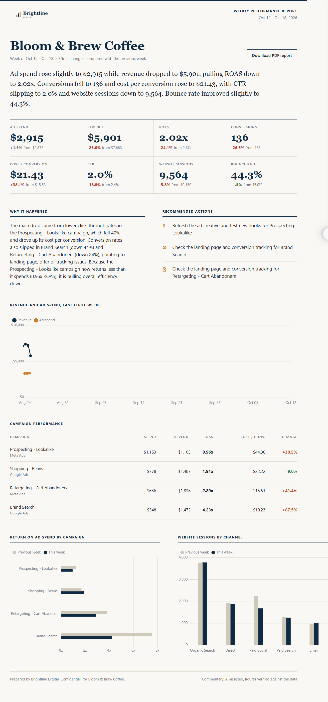
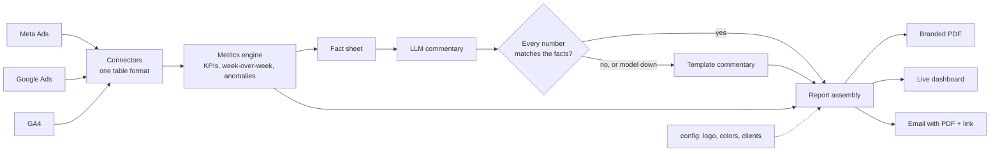
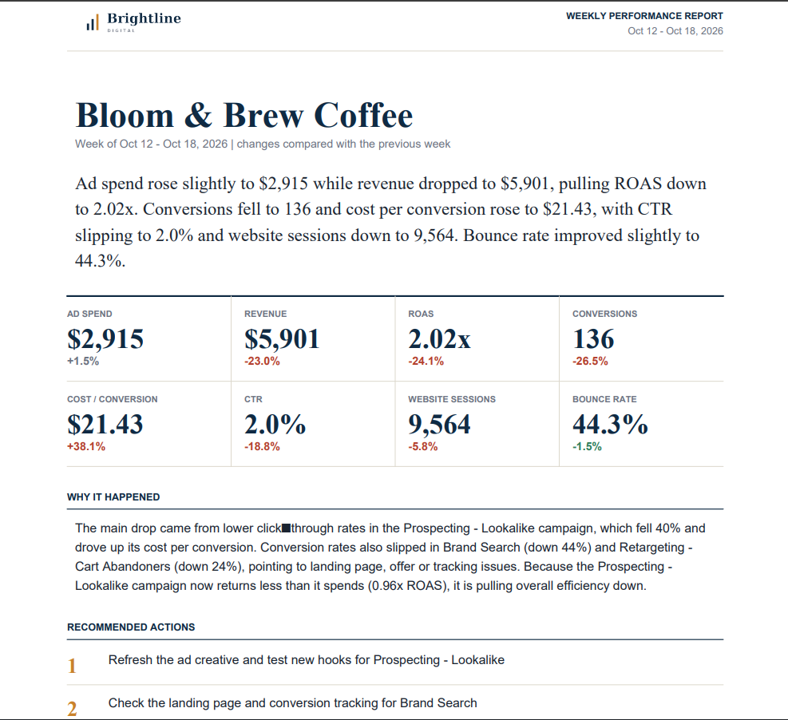

# Automated Client Reporting

**Turns ~3 hours of manual reporting per client per month into a ~5-minute review.**
Pulls ad and analytics data, calculates every number in code, has an AI explain what
happened and what to do next, and delivers a branded PDF, live dashboard and email.

> [!IMPORTANT]
> **This demo uses fictional clients and synthetic data.** No real ad accounts are
> connected. The data connectors are built to be swapped for real Meta Ads, Google Ads and
> GA4 APIs without changing anything else (see [Going to production](#going-to-production)).

**[Live demo](https://mad-iii.github.io/client-reporting-automation/)** |
**[White-label sample](https://mad-iii.github.io/client-reporting-automation/whitelabel/dashboards/index.html)** |
[Sample PDF](samples/SAMPLE.pdf)



## The time saved (and how I got the number)

| | Manual | With this tool |
|---|---|---|
| Per weekly report | ~45 min (pull 3 platforms, build charts, write commentary, format PDF, send) | ~5 min review |
| Per client per month (4 reports) | ~3 hours | ~20 min |
| 20-client agency, per month | ~60 hours | ~7 hours |

These are **my assumptions, not a measured study**: 45 minutes per manual report, 5 minutes
to review a generated one. Replace them with your own team's numbers. Generating the full
pack for 4 clients takes about **1.6543258 seconds** on a laptop.

## How it works



- **Connectors:** one module per source, all returning the same table shape, so real APIs
  replace the demo data without touching the rest.
- **Metrics engine:** every figure is calculated in code (pandas), never by the model.
- **AI commentary:** the model only sees a fact sheet. Each number it writes is checked
  against that sheet.

## Reliability: what happens when the AI fails

Free models get rate-limited and sometimes return bad output, so the pipeline is built to
degrade gracefully:

1. Try model 1, then model 2, then model 3 (free OpenRouter models).
2. If the output has the wrong format, or contains a number that isn't in the data,
   it is rejected.
3. If every model fails, the report still ships, using template commentary built
   from the same facts. The footer states which source wrote the text.

No client ever receives a blank or broken report.

## White-label by design

Everything brand-related lives in config: agency name, tagline, colors, and an optional
`logo_file`. The same code produced two differently branded packs from the same data:

| Brightline Digital (main demo) | Northlake Media ([white-label sample](https://mad-iii.github.io/client-reporting-automation/whitelabel/dashboards/index.html)) |
|---|---|
| navy and copper | plum and teal |

The PDF, dashboard and email all change together.

## Demo vs production

| | This demo | Production |
|---|---|---|
| Data | Synthetic, generated | Meta Marketing, Google Ads and GA4 APIs, with per-client authorization |
| AI model | Free OpenRouter models | Paid model with no-training terms (or a local model), with retries and backoff |
| Delivery | `.eml` files, public GitHub Pages | Transactional email on the agency's domain, login-protected dashboards |
| Safety | Number check, template fallback | Same, plus a human approval step before sending, and failure alerts |

## Run it locally

```bash
pip install -r requirements.txt
python run.py                 # add --no-llm to skip the AI step
python run.py --config config.brand2.yaml --out output/whitelabel
```

Optional: add `OPENROUTER_API_KEY` to a `.env` file for AI-written commentary.

## Stack

Python, pandas, matplotlib, ReportLab, Jinja2, Chart.js, GitHub Actions, OpenRouter.

 

## Going to production

Real connectors, per-client OAuth and token handling, stored weekly snapshots, private
dashboards, a transactional email service, and an approval step before anything is sent.
Details and trade-offs are in the code comments of `connectors/__init__.py`.